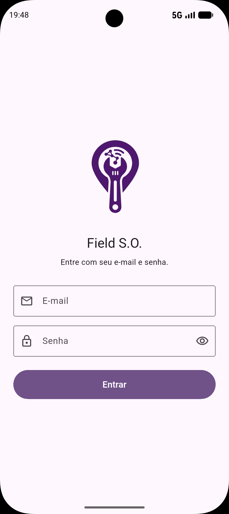
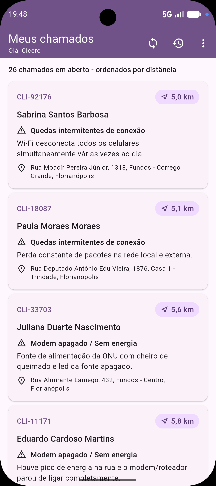
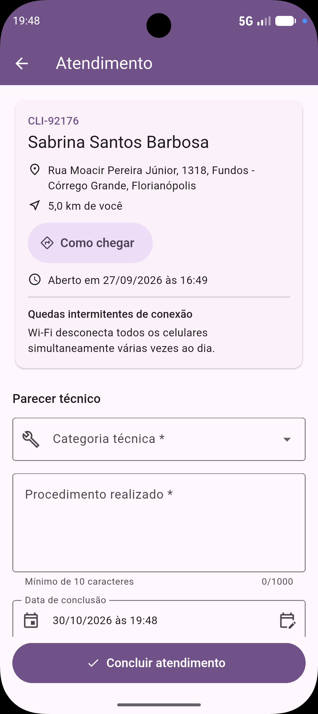
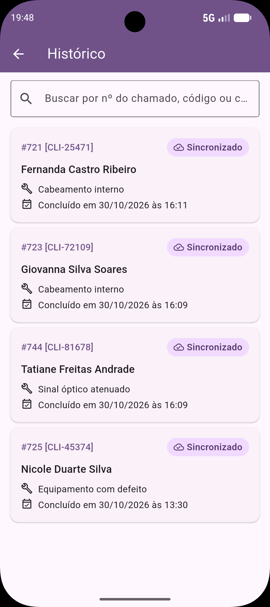
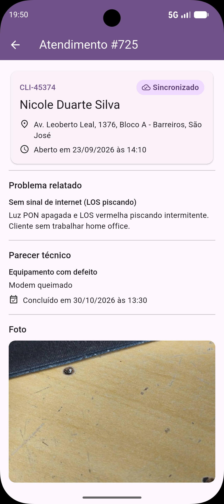

# Field OS - Ordens de Serviço Offline

Um aplicativo Android desenvolvido em Flutter para técnicos de campo de provedores de internet gerenciarem suas ordens de serviço, **funcionando mesmo sem sinal**. Construído com arquitetura **offline-first** em camadas (**Datasource => Repository => ViewModel => View**), com estado via **ChangeNotifier**, injeção de dependência com **get_it** e persistência em **SQLite**. A sincronização com a API REST acontece sempre que houver conexão.

---
## 📸 Demonstração

| Login | Home | Atendimento |
| :---: | :---: | :---: |
|  |  |  |

| Histórico | Detalhe do atendimento |
| :---: | :---: |
|  |  |

---
## 📱 Funcionalidades e Requisitos Implementados

### Arquitetura Offline-First
* **Leitura sempre local:** as telas leem exclusivamente do SQLite. A API é usada apenas para sincronizar.
* **Sincronização:** ao abrir a Home, ao reconectar, ao concluir um atendimento e pelo botão manual. Ordem: envia pendentes => baixa chamados => baixa histórico, sem execuções simultâneas.
* **Padrão Result:** cada Repository retorna `Result<T>` (`Success`/`Failure`), sem exceptions chegando à UI.
* **Banco SQLite:** tabelas `tickets` (chamados) e `service_reports` (atendimentos, com flag `is_synced`).

### Splash e Login
* Auto-login quando há token salvo no `flutter_secure_storage`.
* Senha assinada com **HMAC-SHA256** antes do envio (nunca trafega em texto).
* Após o login, carga inicial dos chamados da API para o SQLite.

### Home
* Lista de chamados abertos com `ListView.builder`, 100% offline.
* Ordenação por proximidade via GPS (fórmula de Haversine), com a distância em km no card.
* Indicador de modo offline e sincronização automática ao reconectar.

### Atendimento
* Formulário com categoria, descrição e data de conclusão, com validação e `SnackBar` de alerta.
* Foto pela câmera ou galeria, salva no armazenamento do aparelho.
* Botão **Como chegar**, que abre a rota no Google Maps.
* Conclusão offline: grava como pendente e remove o chamado da lista da Home.

### Histórico
* Envio dos pendentes em `multipart/form-data`.
* Status de cada atendimento: **Sincronizado**, **Pendente de envio** ou **Erro de envio**.
* Busca em tempo real por número do chamado, código ou nome do cliente.
* Detalhe com a foto local (`Image.file`) ou remota (`Image.network`).

---

## 🚀 Como executar

### Pré-requisitos

- [Flutter SDK](https://docs.flutter.dev/get-started/install) instalado (versão 3.44.4 ou superior)
- Dispositivo Android 6.0+ ou emulador, com GPS

### Passos

```bash
# Clone o repositório
git clone https://github.com/cicerobas/projeto_final_m02.git

# Entre na pasta do projeto
cd projeto_final_m02/

# Instale as dependências
flutter pub get

# Rode o projeto
flutter run

# Rode os testes
flutter test
```

Entre com o e-mail e a senha institucionais cadastrados na API.

### Testando sem internet

1. Faça login com internet para baixar os chamados.
2. Ative o **modo avião**: a lista continua disponível, com o aviso de offline.
3. Conclua um atendimento com foto: ele aparece no Histórico como **Pendente de envio**.
4. Desative o modo avião: o app envia sozinho, e o atendimento passa a **Sincronizado**.

---

## Melhorias Futuras

* Sincronização em segundo plano com o app fechado (`workmanager`).
* Reenvio manual de atendimentos recusados pela API.
* Mais de uma foto por atendimento.
* Mapa com todos os chamados do dia.